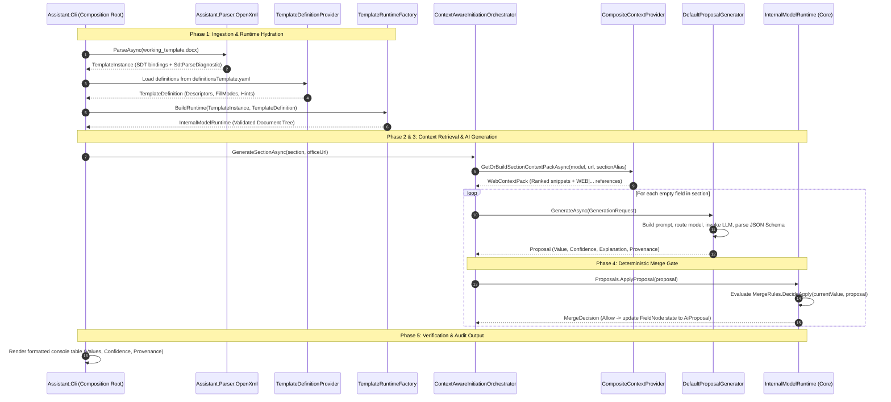

# IK OVS Assistant - Master Implementation Architecture

This document serves as the **master architectural blueprint** of the IK OVS Assistant prototype. It provides a comprehensive top-level overview of the application: its problem domain, multi-layered solution design, end-to-end data lifecycle, component relationships, requirements traceability, and operational instructions.

---

## 1. Executive Summary & Problem Domain

### 1.1 The Challenge: IK OVS Compliance
In the Czech Republic, public administration authorities (Orgány veřejné moci – OVM) are legally mandated under **Act No. 365/2000 Coll.** (ISVS) and **Decree No. 360/2023 Coll.** to create and maintain an **Information Concept of a Public Administration Authority (IK OVS)**. 

The official template is a massive, multi-chapter Microsoft Word document (`.docx`) structured with hundreds of fields across administrative metadata, organizational goals, application architectures, ICT services, budgets, and security parameters. Completing this template manually is labor-intensive, repetitive, and error-prone.

### 1.2 The Assistant's Mission
The Assistant is designed not as an autonomous writer, but as an **interactive, intelligent co-pilot**:
- **Automated Structure Parsing**: Recognizes fillable regions via OpenXML Structured Document Tags (SDTs / Content Controls).
- **Factual Grounding (RAG)**: Extracts context from public office portals to prevent AI hallucinations.
- **Strict Human-in-the-Loop Safeguards**: AI proposals are non-destructive suggestions (`ai_proposal`) that require explicit human approval and never overwrite confirmed or factual data.
- **Full Provenance & Auditability**: Every proposal records its origin, confidence score, and specific source references down to the URL and text chunk.

---

## 2. Architectural Principles

1. **Pure Domain Isolation**: The domain kernel (`Assistant.Core`) has **zero external dependencies**. Business rules, internal document graphs, and merge logic are independent of OpenXML, YAML, or LLM APIs.
2. **One-Way Inward Dependencies**: Application layers flow inward toward the domain kernel. Outer layers (CLI, UI, Pipeline) depend on inner libraries (AI, Dependencies, Parser, Core), never the reverse.
3. **Multi-Source Hybrid Filling**: Fields are populated across distinct modalities:
   - **Deterministic**: Registry lookups (RPP, ARES).
   - **AI Grounded (RAG)**: Generative completion grounded in scraped office texts.
   - **Interactive Chatbot**: Directed interviews for office-specific facts.
   - **Derived / Contextual**: Aggregated from previously confirmed tables.
   - **Manual**: Direct user input or offline Word exports.
4. **Deterministic Merge Gate**: State transitions are strictly governed by `MergeRules`. Confirmed data is immutable to automatic AI overwrites.

---

## 3. High-Level Layered Architecture

The solution is divided into distinct, loosely coupled layers across the `.NET 8` projects:

```
┌─────────────────────────────────────────────────────────────────────────────────────────┐
│                                   PRESENTATION LAYER                                    │
│       Assistant.Cli (Console Runner, DI Root)  │  Assistant.Ui.Avalonia (Desktop GUI)   │
└────────────────────────────────────────────┬────────────────────────────────────────────┘
                                             │
                                             ▼
┌─────────────────────────────────────────────────────────────────────────────────────────┐
│                                   ORCHESTRATION LAYER                                   │
│                                    Assistant.Pipeline                                   │
│        - TemplateRuntimeFactory (Hydration)                                             │
│        - ContextAwareInitiationOrchestrator (Prefill Coordination)                      │
└───────────────────────┬────────────────────┬────────────────────┬───────────────────────┘
                        │                    │                    │
                        ▼                    ▼                    ▼
┌──────────────────────────────┐ ┌──────────────────────┐ ┌──────────────────────────────┐
│       AI & REASONING         │ │  RETRIEVAL & SCHEMAS │ │     TEMPLATE PARSER          │
│        Assistant.AI          │ │Assistant.Dependencies│ │ Assistant.Parser.OpenXml     │
│ - Prompt Engineering         │ │ - Web RAG Engine     │ │ - OpenXML DOCX Traversal     │
│ - OpenAI Structured Outputs  │ │ - Apify Crawler      │ │ - SdtElement Extraction      │
│ - Strict JSON Schema V1      │ │ - Lucene Czech NLP   │ │ - Alias Validation           │
│ - Model Routing Policies     │ │ - BM25 Indexing      │ │ - Diagnostic Accumulation    │
│ - Deterministic Fake Mock    │ │ - YAML Schema Mapper │ │                              │
└──────────────────────────────┘ └──────────────────────┘ └──────────────────────────────┘
                        │                    │                    │
                        └────────────────────┼────────────────────┘
                                             │
                                             ▼
┌─────────────────────────────────────────────────────────────────────────────────────────┐
│                                   CORE DOMAIN KERNEL                                    │
│                                     Assistant.Core                                      │
│  - InternalModel & Runtime State              - Strongly Typed Aliases (Field/Section)  │
│  - FieldNode Aggregate (Metadata, State, Dep) - Section Graph Index & Cycle Detection   │
│  - Lifecycle States (FieldStatus)             - Deterministic Merge Gate (MergeRules)   │
│  - Immutable Proposal & Audit Contracts       - Zero External Dependencies (Pure .NET 8)│
└─────────────────────────────────────────────────────────────────────────────────────────┘
```

---

## 4. End-to-End System Data Lifecycle

The running prototype executes the following 5-phase data pipeline:



### Detailed Phase Breakdown:
1. **Ingestion & Hydration**:
   - `OpenXmlTemplateSdtParser` scans the `.docx` file for SDT controls, extracting unique SDT IDs, tags, and occurrence counts.
   - `TemplateDefinitionProvider` deserializes and validates `definitionsTemplate.yaml` (snake_case YAML to strongly typed descriptors).
   - `TemplateRuntimeFactory` verifies that physical SDTs correspond 1-to-1 with logical definitions (detecting `DOCX_UNKNOWN_ALIAS` or fatal `DOCX_DUPLICATE_ALIAS`), constructing the active `InternalModelRuntime`.
2. **Context Retrieval (Local RAG)**:
   - Given a public authority URL (e.g. `https://www.mmr.gov.cz/`), `CompositeContextProvider` ensures pages are crawled via Apify (respecting URL exclusions like news, cookies, galleries).
   - Pages are hashed (SHA-256), chunked into heading-aware blocks (200–1000 characters), tokenized with `Lucene.Net` CzechAnalyzer, and indexed with corpus-wide Robertson-Spärck Jones IDF statistics.
   - For the active section, `SectionQueryBuilder` generates search terms from section names, ancestor chapters, and field hints.
   - `WebSectionPackRetriever` applies BM25 scoring with URL path matching boosts, negative keyword penalties, and MMR-style URL diversity reranking. Results are cached in `.office-cache/`.
3. **Structured AI Generation**:
   - `MinimalPromptBuilder` combines field definitions, expected data types, custom instructions, and truncated web snippets.
   - Injects the strict JSON Schema `proposal.v1.schema.json`.
   - `OpenAiChatLlmProvider` calls OpenAI using native structured outputs (`ChatResponseFormat.CreateJsonSchemaFormat`) or delegates to web search (`openai-web`).
4. **Strict Schema Parsing & Validation**:
   - `StrictJsonProposalParser` extracts the JSON object, validates required keys (`value`, `confidence`, `explanation`), normalizes confidence to $[0.0, 1.0]$, and tags model provenance (`OpenAi:gpt-5-nano (req:...)`).
5. **Deterministic Merge Gate**:
   - `ProposalApplier` routes the proposal through `MergeRules.DecideApply`.
   - If the field is currently `Empty` or `NeedsValidation`, the proposal is accepted and sets status to `AiProposal`.
   - If the field is already `Confirmed`, `UserInput`, or `Deterministic`, the proposal is rejected from automatic overwrite, safeguarding human-entered or verified facts.

---

## 5. Subsystem Documentation Index

For in-depth technical specifications, algorithm formulas, and class contracts, refer to the dedicated documentation files:

| Subsystem | Documentation File | Core Topics Covered |
|-----------|--------------------|---------------------|
| **Core Domain Kernel** | [`core.md`](./core.md) | `FieldNode` aggregate, `FieldValue` snapshots, `FieldAlias` / `SectionAlias` validation, `SectionGraphIndex` cycle detection, and `MergeRules` decision matrix. |
| **Context Retrieval (RAG)** | [`context-retrieval.md`](./context-retrieval.md) | Apify crawler options, Lucene Czech NLP, block chunking, BM25 mathematical formulation, URL match boost, negative word penalty, and `.office-cache/` layout. |
| **Dependencies & Schemas** | [`dependencies.md`](./dependencies.md) | `definitionsTemplate.yaml` structure, `TemplateDefinitionValidator`, fill mode bitwise translation, and `CompositeContextProvider` facade. |
| **AI & LLM Integration** | [`ai.md`](./ai.md) | `DefaultProposalGenerator`, `MinimalPromptBuilder`, OpenAI Structured Outputs, `proposal.v1.schema.json` contract, confidence normalization, and offline `FakeLlmProvider`. |
| **Prompt Engineering & Templates** | [`prompts.md`](./prompts.md) | Exact system/user prompt templates, context truncation rules, dynamic field variables, OpenAI web search augmentation, and schema binding. |
| **OpenXML Template Parser** | [`parser-openxml.md`](./parser-openxml.md) | Word `.docx` package traversal, SDT content control property extraction (`SdtId`, `Tag`), occurrence indexing, and diagnostic codes (`DOCX_NO_BODY`, `SDT_MISSING_TAG`, `SDT_INVALID_ALIAS`). |
| **Pipeline & Orchestration** | [`pipeline.md`](./pipeline.md) | `TemplateRuntimeFactory` hydration, `ContextAwareInitiationOrchestrator` workflow, and dual retrieval switching (local RAG vs. OpenAI Responses). |
| **CLI & Composition Root** | [`cli.md`](./cli.md) | ServiceCollection dependency injection setup, `ConfigurationLoader` (`config.local.ini` and environment variables), and `PrefaceBasicInfoSectionExperiment` execution. |

---

## 6. Analytical Requirements Traceability

The implementation directly operationalizes the analytical requirements specified in `docs/requirements/`:

| Requirement ID | Requirement Name | Implementing Module | Operational Status |
|----------------|------------------|---------------------|--------------------|
| **REQ_MODEL_PARSE** | SDT Parsing into Internal Model | `Assistant.Parser.OpenXml`, `Assistant.Pipeline` | **Implemented**: Parses Word SDTs and maps them into `InternalModelRuntime`. |
| **REQ_TEMPLATE_VALIDATE** | Minimum Template Validation | `Assistant.Parser.OpenXml`, `Assistant.Dependencies` | **Implemented**: Accumulates parse diagnostics and validates YAML alias integrity. |
| **REQ_MODEL_DEPENDENCIES** | Field Dependency Calculation | `Assistant.Core` (`Model/Dependencies`) | **Core Models Ready**: `DependencyTracker` and `DependencySnapshot` track blocking fields. |
| **REQ_DATA_RAG** | Context Retrieval Mechanism | `Assistant.Dependencies/Context` | **Implemented**: End-to-end web crawler, Lucene tokenizer, BM25 ranker, and cache store. |
| **REQ_01** | Deterministic Pre-fill from Registries | `Assistant.Core` (`MergeRules`) | **In Progress**: Domain states and merge gate are ready; RPP / ARES adapters in design. |
| **REQ_02** | AI Fill from Public Sources | `Assistant.AI`, `Assistant.Pipeline` | **Implemented**: Generates grounded AI proposals for section fields (`PREFACE_BASIC-INFO`). |
| **REQ_03** / **REQ_04** | AI Table & Text Block Generation | `Assistant.Core` (`FieldContentKind`) | **Design**: Multi-field chunking and section-level prompt builders in preparation. |
| **REQ_EXPORT_SECTION** | Section Export for Offline Completion | `Assistant.Core/Merge` | **Design**: Merge decision rules exist; OpenXML serializer in preparation. |
| **REQ_MERGE_SECTION** | Section Merge Back to Model | `Assistant.Core/Merge` | **Design**: `MergeRules` natively handle `UserInput` promotion over `AiProposal`. |
| **REQ_CHAT_*** | Interactive Chatbot Prefill | `Assistant.Core` (`FillMode.Chatbot`) | **Concept**: Flags and interactive status transitions (`AiInteractive`) defined in Core. |

---

## 7. Current Project Status & Roadmap

### What is Completed & Verifiable Today:
- [x] Full OpenXML DOCX parser extracting SDTs and validating `FieldAlias` tags.
- [x] Declarative YAML template schema loader with diagnostics and fallback heuristics.
- [x] Complete local Web RAG engine with headless crawling (Apify), Czech NLP (`Lucene.Net` 4.8), BM25 scoring with boosts/penalties, and disk caching.
- [x] OpenAI client integration supporting Structured Outputs adhering to `proposal.v1.schema.json`.
- [x] Offline `FakeLlmProvider` for deterministic unit testing.
- [x] Pure domain kernel with typed aliases, section graph index, and non-destructive merge gate.
- [x] Runnable end-to-end experiment (`PrefaceBasicInfoSectionExperiment`) populating `IKOVS_PREFACE_BASIC-INFO` from ministry websites.

### Next Development Milestones:
1. **Public Registry Adapters (`REQ_01`)**: Connect deterministic connectors for the Registry of Rights and Duties (RPP) and Business Register (ARES) to populate factual identifiers before AI prefill.
2. **Section-Level Structured Generation (`Method B / REQ_03`)**: Extend `MinimalPromptBuilder` to support generating all empty fields in a section simultaneously.
3. **Template Export & Merge (`REQ_EXPORT_SECTION`, `REQ_MERGE_SECTION`)**: Generate partial `.docx` files for offline completion and merge them back into `InternalModelRuntime`.
4. **Desktop UI (`Assistant.Ui.Avalonia`)**: Connect the Avalonia GUI prototype to the active `InternalModelRuntime` for visual field review, proposal regeneration, and acceptance.

---

## 8. Getting Started & Operations

### 8.1 Prerequisites
- **.NET SDK 8.0+**
- **OpenAI API Key** (set via environment variable `OPENAI_API_KEY` or `config.local.ini`)
- **Apify API Token** (set via environment variable `APIFY_API_KEY` or `config.local.ini`)

### 8.2 Configuration (`config.local.ini`)
Optionally create `config.local.ini` in the working directory (automatically ignored by Git):
```ini
[OpenAI]
ApiKey=sk-...

[Apify]
ApiToken=apify_api_...
```

### 8.3 Operational Environment Variables
- `ASSISTANT_CONTEXT_MODE`:
  - `local` (default): Uses the local Web RAG crawler and BM25 search engine.
  - `openai-web`: Bypasses local crawler and invokes the OpenAI Responses API with native web search.
- `ASSISTANT_RETRIEVER_DEBUG`: Set to `1` to enable verbose BM25 scoring and candidate ranking logs in the console.

### 8.4 Build and Run
```powershell
# Build entire solution
dotnet build Assistant.sln

# Run the CLI experiment
dotnet run --project src/Assistant.Cli
```
