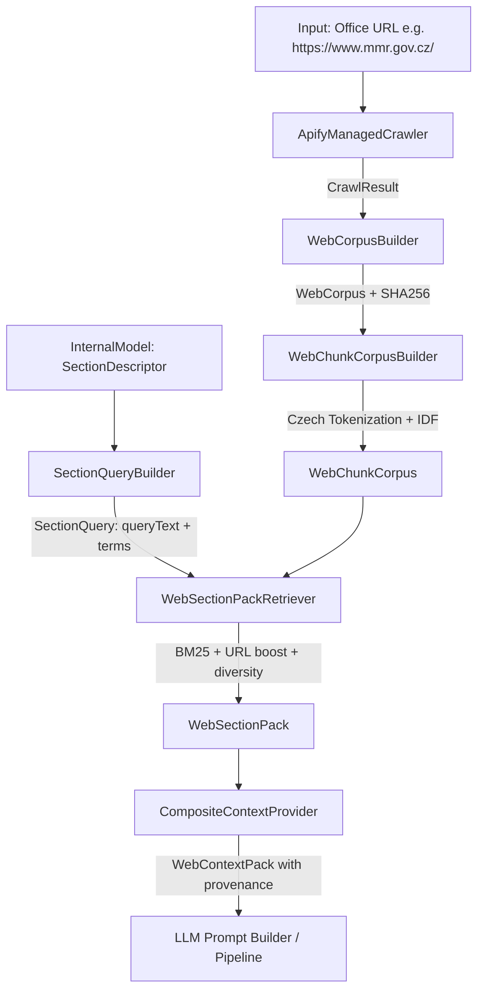

# Context Retrieval Subsystem (Web RAG Engine)

This document provides a detailed description of the architecture and inner workings of the context retrieval module (`Assistant.Dependencies/Context`), which fulfills the **`REQ_DATA_RAG`** requirement for the IK OVS Assistant.

---

## 1. Motivation and Objective

Populating key sections of an IK OVS document (e.g., public office mandate, organizational responsibilities, strategic ICT goals) cannot rely solely on structured registry records. At the same time, generative models must not hallucinate facts.

The subsystem achieves:
- **Automated text extraction** from official public office websites (`WEB_OFFICE`).
- **Text cleaning and segmentation** into coherent chunks respecting document and heading boundaries.
- **Czech Natural Language Processing (NLP)** (stemming, diacritics normalization, stop-word removal).
- **Information Retrieval (IR)** tailored to specific template sections via an enhanced **BM25** ranking algorithm.
- **Strict auditability and provenance** for every snippet injected into LLM prompts.
- **Multi-tier disk caching** to prevent redundant scraping and re-computation.

---

## 2. Processing Pipeline



---

## 3. Subsystem Components

### 3.1 Web Crawling (`Context/Web/Crawling/`)
- **Interface**: `IManagedCrawler` exposing `RunAsync(officeIdentifier, cancellationToken)`.
- **Implementation**: `ApifyManagedCrawler` running the Apify actor `apify/website-content-crawler`.
- **URL Filtering**:
  The crawler automatically excludes irrelevant or noisy page categories via glob patterns:
  - News and press releases: `**/novinky/**`, `**/aktuality/**`
  - Photo galleries and media: `**/fotogalerie/**`, `**/galerie/**`
  - Search interfaces: `**/search**`, `**?*query=*`
  - Legal, accessibility, and cookie notices: `**/cookies**`, `**/gdpr**`, `**/privacy**`, `**/pristupnost**`
- **Output**: `CrawlResult` containing a collection of crawled pages (`CrawlPage`: URL, retrieval timestamp, cleaned extracted text).

### 3.2 Corpus Construction and Chunking (`Context/Web/Processing/`)
- **`WebCorpusBuilder`**:
  - Computes a SHA-256 hash of the extracted text for each page (`ContentHash`).
  - Assembles the initial raw corpus `WebCorpus`.
- **`WebTextChunker`**:
  - Splits continuous text into logical blocks based on empty lines.
  - Recognizes heading boundaries (short lines ending with colons, or lines with $\ge 70\%$ uppercase characters).
  - Emits chunks constrained between 200 and 1,000 characters (max 50 lines per chunk).
- **`WebChunkCorpusBuilder`**:
  - Deduplicates pages by URL and content hash, while discarding navigation noise (blocks dominated by short lines $\le 25$ characters).
  - Tokenizes chunk text using `LuceneCzechTokenizer`.
  - Calculates Document Frequency ($DF$) and Robertson-Spärck Jones Inverse Document Frequency ($IDF$) across all corpus chunks:
    $$IDF(t) = \ln\left(1 + \frac{N - DF(t) + 0.5}{DF(t) + 0.5}\right)$$

### 3.3 Czech NLP & Tokenization (`LuceneCzechTokenizer`)
- Powered by `Lucene.Net.Analysis.Cz.CzechAnalyzer` (Lucene 4.8).
- Features:
  - Removal of Czech stop words (prepositions, conjunctions, pronouns).
  - Czech light stemming and suffix stripping.
  - Case folding and diacritic handling.
  - Discarding tokens with fewer than 3 characters (`MinimumTokenLength`).

### 3.4 Section Query Formulation (`SectionQueryBuilder`)
Search queries are dynamically constructed from the section’s placement and metadata in the internal document model:
1. **Primary Section Term**: Display name (`DisplayName`) or derived from the alias (e.g. `IKOVS_PREFACE_BASIC-INFO` $\rightarrow$ `PREFACE BASIC INFO`).
2. **Section Hints (`QueryHints`)**: Explicit domain keywords defined in the template YAML (e.g., `název úřadu`, `sídlo`, `kontakty`).
3. **Ancestors in Hierarchy**: Display names of parent sections/chapters (up to 2 ancestors).
4. **Child Fields**: Display names and query hints of fields assigned to the section (up to 8 fields).
5. **Length Enforcement**: Assembled terms are deduplicated case-insensitively and limited to `MaximumTotalCharacters` (default 420 chars).

### 3.5 Relevance Ranking Engine (`WebSectionPackRetriever`)
Candidate chunks are scored and reranked using a tailored hybrid algorithm:

1. **BM25 Core Score**:
   $$BM25 = \sum_{t \in Q} IDF(t) \cdot \frac{TF(t, D) \cdot (k_1 + 1)}{TF(t, D) + k_1 \cdot \left(1 - b + b \cdot \frac{|D|}{\text{avgdl}}\right)}$$
   with parameters $k_1 = 1.2$, $b = 0.75$.
2. **Negative Keyword Penalty**:
   If a chunk contains distracting terms (e.g., *kariéra, zaměstnání, plat, aktuality, galerie, nabízíme*), an exponential penalty is applied:
   $$\text{score} = \text{score} \cdot 0.9^{\text{negative\_token\_count}}$$
3. **Query Coverage Boost**:
   Chunks matching a higher fraction of distinct query tokens receive up to a $+20\%$ boost.
4. **URL Path Match Boost**:
   If the source URL path contains query tokens (e.g., `/o-ministerstvu/kontakty`), the score is boosted ($+14\%$ for exact token matches, $+20\%$ for prefix matches).
5. **URL Diversity (MMR-style Reranking)**:
   Repeated chunks from the same URL incur a penalty:
   $$\text{score}_{\text{adj}} = \frac{\text{score}}{1.0 + 0.3 \cdot \text{chunks\_already\_selected\_from\_this\_url}}$$
   This enforces source diversity and limits results to at most 2 chunks per URL (configurable).
6. **Sentence-Boundary Trimming**:
   If the cumulative snippet character limit (e.g. 5,000 characters) is reached, overflowing text is cleanly trimmed at the last sentence terminator (`.`, `?`, `!`).

### 3.6 Persistence & Tiered Cache (`OfficeCacheStore`)
Data is stored locally under `.office-cache/{officeKey}/`:
- `corpus.json`: Raw crawled pages with content hashes.
- `chunk-corpus.json`: Processed chunks, token frequencies, and corpus IDF statistics.
- `section-pack-{sectionKey}.json`: Cached ranked items for a specific section and query.
- `context-pack.json`: Aggregate context pack across sections.

The retrieval pipeline checks cache layers hierarchically:
1. `section-pack` exists with matching query $\rightarrow$ Return immediately.
2. `chunk-corpus` exists $\rightarrow$ Perform BM25 ranking locally; skip crawling and chunking.
3. Raw `corpus` exists $\rightarrow$ Re-chunk and compute statistics locally; skip crawling.
4. No cache exists $\rightarrow$ Execute live Apify web crawl.

---

## 4. Provenance Data Contract (`REQ_DATA_RAG`)

Each retrieved snippet within `WebContextPack` carries a structured provenance identifier:
```text
WEB|{officeKey}|{sectionKey}|{chunkId}
```
Example:
```text
WEB|mmr-gov-cz|IKOVS_PREFACE_BASIC-INFO|a8f2b1c4e9..._3
```
- `mmr-gov-cz`: Normalized office key.
- `IKOVS_PREFACE_BASIC-INFO`: Target section alias.
- `a8f2b1c4e9..._3`: Page content SHA-256 hash and 0-based chunk index.

This identifier is stored alongside field proposals (`Proposal.ProvenanceSources`), guaranteeing complete traceability from the public web page directly to the generated field in the Word document.
