# Dependencies Subsystem (`Assistant.Dependencies`)

This document describes the high-level architecture of `Assistant.Dependencies`, which serves as the integration, metadata ingestion, and external capability layer for the Assistant.

For low-level algorithmic details of the web crawler and BM25 search engine, refer to the dedicated [Context Retrieval Documentation](./context-retrieval.md).

---

## 1. Architectural Role

`Assistant.Core` defines pure domain entities and business rules (`InternalModel`, `FieldNode`, `Proposal`, `MergeRules`) without depending on third-party libraries or I/O mechanisms.

`Assistant.Dependencies` bridges the domain model with external technologies:
- **Declarative YAML Template Definitions**: Ingests, validates, and maps human-readable template schemas into strongly typed `TemplateDefinition` objects.
- **Web Scraping & NLP Retrieval**: Crawls office portals, tokenizes Czech text, and ranks snippets via BM25 to ground AI prompts.
- **Composite Context Provider**: Exposes a unified facade (`CompositeContextProvider`) for high-level pipeline consumers.

```
┌────────────────────────────────────────────────────────┐
│                   Assistant.Pipeline                   │
└───────────────────────────┬────────────────────────────┘
                            │
                            ▼
┌────────────────────────────────────────────────────────┐
│                 Assistant.Dependencies                 │
│  ┌────────────────────────┐  ┌───────────────────────┐ │
│  │  TemplateDefinitions/  │  │       Context/        │ │
│  │ (YAML schema mapping)  │  │ (Web RAG, BM25, Lucene│ │
│  └────────────────────────┘  └───────────────────────┘ │
│                            ▲                           │
│                            │ (Facade)                  │
│               CompositeContextProvider                 │
└───────────────────────────┬────────────────────────────┘
                            │
                            ▼
┌────────────────────────────────────────────────────────┐
│                     Assistant.Core                     │
│    (InternalModel, FieldNode, SectionDescriptor, etc.) │
└────────────────────────────────────────────────────────┘
```

---

## 2. Template Definitions Subsystem (`TemplateDefinitions/`)

### 2.1 The Need for Declarative Metadata
While `working_template.docx` contains structural SDT content controls, DOCX files alone do not carry essential metadata such as:
- Which fields are fillable by AI vs. deterministic registries vs. chatbot (`FillMode`).
- Czech display labels (`LabelCs`).
- Domain-specific search hints for context retrieval (`QueryHints`).
- Mandatory vs. optional constraints (`Required`).
- Value data type hints (`ValueType`).

This metadata is declared in `src/templates/definitionsTemplate.yaml` and loaded at runtime.

### 2.2 Processing Pipeline

```mermaid
flowchart LR
    A[definitionsTemplate.yaml] --> B[TemplateDefinitionSource]
    B -->|DefinitionTemplate DTOs| C[TemplateDefinitionValidator]
    C -->|Warnings| D[TemplateDefinitionMapper]
    D -->|TemplateDefinition| E[TemplateDefinitionProvider]
    E -->|ITemplateDefinitionProvider| F[Pipeline / CLI]
```



1. **Deserialization (`TemplateDefinitionSource`)**:
   Uses `YamlDotNet` configured with `UnderscoredNamingConvention` to parse YAML keys (e.g., `label_cs`, `query_hints`, `value_type`) into internal DTOs (`DefinitionFile`, `DefinitionTemplate`, `DefinitionSection`, `DefinitionField`).
2. **Structural Validation (`TemplateDefinitionValidator`)**:
   Enforces schema integrity before mapping:
   - Detects empty or duplicate section aliases (`DEF_SECTION_EMPTY_ALIAS`, `DEF_DUPLICATE_SECTION_ALIAS`).
   - Detects empty or duplicate field aliases (`DEF_FIELD_EMPTY_ALIAS`, `DEF_DUPLICATE_FIELD_ALIAS`).
   - Verifies that section and field parent references resolve to existing sections (`DEF_UNKNOWN_SECTION_PARENT`, `DEF_UNKNOWN_FIELD_PARENT`).
   - Collects non-fatal `TemplateDefinitionWarning` records so loading can continue where possible.
3. **Domain Mapping (`TemplateDefinitionMapper`)**:
   Translates validated DTOs into immutable `Assistant.Core` objects:
   - Evaluates boolean fill flags into bitwise `FillMode` enum values (`Deterministic`, `Ai`, `Chatbot`).
   - Validates aliases using `SectionAlias.TryCreate` and `FieldAlias.TryCreate`.
   - Links field aliases into parent `SectionDescriptor` instances.
   - Preserves declared `ContextSources` for per-field provenance targeting.
4. **Provider Registry (`TemplateDefinitionProvider`)**:
   Implements `ITemplateDefinitionProvider`. Holds loaded definitions in memory and enables version lookup via `TryGetDefinition(templateVersion, ...)`.

---

## 3. Context Subsystem Integration (`Context/`)

The `Context/` folder houses the full-featured Web RAG engine:
- **`IManagedCrawler` / `ApifyManagedCrawler`**: Headless web crawling of target office websites.
- **`LuceneCzechTokenizer`**: Czech morphological analysis and stemming using `Lucene.Net` 4.8.
- **`WebChunkCorpusBuilder` & `WebTextChunker`**: Heading-aware text segmentation and corpus IDF statistics.
- **`SectionQueryBuilder`**: Dynamic search query formulation using section hierarchy and field hints.
- **`WebSectionPackRetriever`**: BM25 scoring with URL path matching boosts and negative word penalties.
- **`OfficeCacheStore`**: Local multi-tier JSON disk cache under `.office-cache/`.

### 3.1 Composite Context Facade (`CompositeContextProvider`)
`CompositeContextProvider` is the primary entry point consumed by the rest of the application:
- Coordinates the crawling of the office portal (or pulls from cache).
- Lazily builds `SectionQuery` for requested sections.
- Executes BM25 chunk retrieval.
- Wraps results into `WebContextSnippet` objects bearing standardized provenance IDs:
  ```text
  WEB|{officeKey}|{sectionKey}|{chunkId}
  ```
- Packages snippets into a `WebContextPack` ready for prompt generation.

---

## 4. External Dependencies

| Package | Version | Purpose |
|---------|---------|---------|
| `YamlDotNet` | `16.3.0` | High-performance YAML parsing and deserialization of template definition files. |
| `Lucene.Net` | `4.8.0-beta00016` | Port of Apache Lucene for .NET used for text search infrastructure and analyzers. |
| `Lucene.Net.Analysis.Common` | `4.8.0-beta00016` | Provides `CzechAnalyzer` for Czech stemming, accents, and stop-word filtering. |
| `Assistant.Core` | (Project Ref) | Core domain abstractions, internal model, and value objects. |
