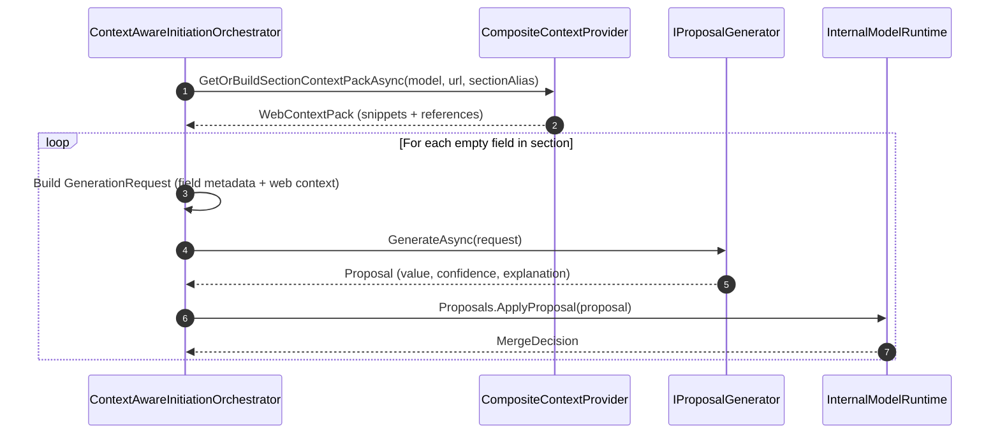

# Pipeline Subsystem (`Assistant.Pipeline`)

This document describes the orchestration architecture and workflow lifecycle implemented in `Assistant.Pipeline`.

---

## 1. Architectural Role

`Assistant.Pipeline` serves as the end-to-end integration and workflow engine of the Assistant. It composes the parser (`Assistant.Parser.OpenXml`), metadata definitions and context retrieval (`Assistant.Dependencies`), AI generation (`Assistant.AI`), and domain runtime state (`Assistant.Core`).

```
┌────────────────────────────────────────────────────────┐
│               Assistant.Cli / Avalonia UI              │
└───────────────────────────┬────────────────────────────┘
                            │
                            ▼
┌────────────────────────────────────────────────────────┐
│                   Assistant.Pipeline                   │
│                                                        │
│  ┌─────────────────────────┐  ┌──────────────────────┐ │
│  │  TemplateRuntimeFactory │  │ ContextAwareInitiat- │ │
│  │ (DOCX SDT + YAML -> Mdl)│  │ ionOrchestrator      │ │
│  └─────────────────────────┘  └──────────────────────┘ │
└───────┬───────────────────┬──────────────┬─────────────┘
        │                   │              │
        ▼                   ▼              ▼
┌───────────────┐   ┌───────────────┐ ┌──────────────────┐
│ Parser.OpenXml│   │ Dependencies  │ │   Assistant.AI   │
│ (TemplateInst)│   │ (Definitions, │ │(ProposalGenerat-)│
└───────────────┘   │  ContextPack) │ └──────────────────┘
                    └───────────────┘
                            │
                            ▼
                    ┌───────────────┐
                    │Assistant.Core │
                    │(ModelRuntime) │
                    └───────────────┘
```

---

## 2. Core Workflows

### 2.1 Runtime Hydration (`TemplateRuntimeFactory`)
Before any fields can be filled, the document's physical content controls must be reconciled with logical domain descriptors:

```csharp
TemplateRuntimeBuildResult result = runtimeFactory.BuildRuntime(instance, definition);
```

#### Workflow Steps:
1. **Input Intake**:
   - `TemplateInstance`: Physical SDT bindings parsed from OpenXML (`FieldBinding`: alias, SDT ID, occurrence index, content kind).
   - `TemplateDefinition`: Logical schema loaded from YAML (`FieldDescriptor`, `SectionDescriptor`, hierarchy, fill modes).
2. **Structural Integrity Check**:
   - Compares physical SDT aliases against logical YAML descriptors.
   - Any physical SDT alias missing from the definition is recorded as `DOCX_UNKNOWN_ALIAS`.
   - Any duplicate SDT alias within the document is flagged as `DOCX_DUPLICATE_ALIAS` and aborts runtime creation.
3. **Runtime Instantiation**:
   - If valid, calls `InternalModelRuntimeBuilder.Build` to create an immutable `InternalModel` and active `InternalModelRuntime`.
   - Returns a `TemplateRuntimeBuildResult` with diagnostics.

---

### 2.2 Context-Aware Initiation Orchestrator (`ContextAwareInitiationOrchestrator`)
Drives the initial prefill phase (`REQ_02`) across sections or individual fields:



#### Dual Retrieval Modes:
- **Local RAG Mode (Default)**:
  - Invokes `CompositeContextProvider` to crawl/load the office corpus.
  - Retrieves BM25-ranked chunks for the target section.
  - Combines document context with retrieved web text and attaches provenance references (`WEB|{officeKey}|{sectionKey}|{chunkId}`).
- **OpenAI Web Search Mode (`ASSISTANT_CONTEXT_MODE="openai-web"`)**:
  - Bypasses local crawling and retrieval entirely.
  - Injects target authority name and URL directly into prompt instructions.
  - Leaves web retrieval to the OpenAI Responses API.

#### Proposal Application:
For each generated `Proposal`, the orchestrator invokes `internalModelRuntime.Proposals.ApplyProposal(proposal)`. This executes domain merge rules in `Assistant.Core.Merge`, updates the `FieldNode` status to `AiProposal`, and logs provenance in the audit trail.

---

## 3. Requirements Traceability

| Requirement | Stage | How Pipeline Fulfills It |
|-------------|-------|--------------------------|
| **REQ_MODEL_PARSE** | Initiation | `TemplateRuntimeFactory` connects parsed SDT tags to `InternalModelRuntime`. |
| **REQ_TEMPLATE_VALIDATE** | Pre-Flight | Collects and aggregates parsing diagnostics (`SdtParseDiagnostic`). |
| **REQ_DATA_RAG** | Prefill | Retrieves section-specific snippets via `CompositeContextProvider` and passes references into generation requests. |
| **REQ_02** | Prefill | Generates and records non-destructive AI proposals for unfilled fields. |
