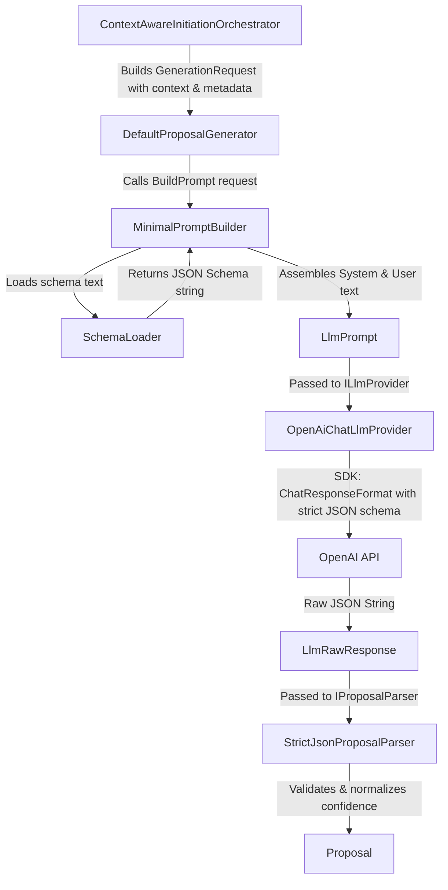

# Prompt Engineering & Prompt Templates (`Assistant.AI`)

This document provides a comprehensive, exact specification of how prompts are structured, dynamically assembled, constrained, and handled within the IK OVS Assistant.

---

## 1. Overview & Prompt Philosophy

The assistant implements **Field-Level Prefill (Method A)** as defined in `docs/EvaluationMethods.md`. The design goals are:
1. **Atomic Reasoning**: Each LLM call is focused on filling exactly one field (`FieldAlias`) in the document template.
2. **Zero Hallucination / Grounded Context**: The model is provided with retrieved external text chunks (`Context`) and explicit metadata instructions (`Instructions`).
3. **Strict Machine-Readable Output**: The model is forbidden from generating conversational preambles, apologies, or markdown code fences (` ```json `). Output must be a single raw JSON object adhering to `proposal.v1.schema.json`.
4. **Calibrated Confidence**: The model must assign a numerical confidence score ($0.0$ to $1.0$) and a concise rationale (`explanation`).

---

## 2. Core Prompt Structure (`MinimalPromptBuilder`)

Prompts are constructed by `MinimalPromptBuilder` (implementing `IPromptBuilder`) and split into two distinct messages: **System Prompt** and **User Prompt**.

### 2.1 System Prompt

The system prompt defines the model's role, enforces format restrictions, and embeds the complete JSON Schema Draft 2020-12 definition.

#### Exact Template:
```text
You fill exactly one field in a structured document.

You MUST return exactly one JSON object that conforms to the following JSON Schema.
Do not include markdown.
Do not include explanations outside the JSON.
Do not include additional properties.

JSON Schema:
{JSON_SCHEMA_TEXT}
```

Where `{JSON_SCHEMA_TEXT}` is dynamically loaded from `Schemas/proposal.v1.schema.json` via `SchemaLoader`.

---

### 2.2 User Prompt

The user prompt supplies the task description, target field metadata, custom instructions, and truncated context snippets.

#### Exact Template:
```text
Task
Fill the following field.

Field
Alias: {request.Alias.Value}
DisplayName: {descriptor.DisplayName}           <-- (Included only if non-empty)
ValueTypeHint: {descriptor.ValueTypeHint}       <-- (Included only if non-empty)
Mode: {request.Mode}

Instructions                                    <-- (Included only if descriptor has Instructions)
{descriptor.Instructions}

Context                                         <-- (Included only if DocumentContextText is present)
{normalizedContext}

Remember
Return only the JSON object, nothing else.
```

---

## 3. Dynamic Variables & Context Shaping

### 3.1 Dynamic Field Variables
- **`request.Alias.Value`**: The strongly typed alias from `FieldAlias` (e.g. `IKOVS_PREFACE_BASIC-INFO_ORG_NAME`).
- **`descriptor.DisplayName`**: Human-readable Czech label defined in `definitionsTemplate.yaml` (e.g. `Název orgánu veřejné správy`).
- **`descriptor.ValueTypeHint`**: Expected data format hint (e.g. `string`, `date`, `ico`, `number`).
- **`request.Mode`**: Generation mode (`InitialPrefill`, `Regenerate`, or `Improve`).
- **`descriptor.Instructions`**: Domain-specific guidance configured per-field (e.g., `Uveďte přesný oficiální název ministerstva podle zřizovacího zákona.`).

### 3.2 Context Truncation Rules (`NormalizeContext`)
To prevent exceeding context windows and token budgets, context text is shaped according to strict rules:
1. **Newline Normalization**: Converts `\r\n` to `\n` and trims edge whitespace.
2. **Character Ceiling**:
   - Reads `descriptor.ContextRequirement.MaxCharacters` if defined on the field.
   - If not defined or $\le 0$, defaults to **3,000 characters** (`DefaultMaxContextCharacters`).
3. **Truncation Marker**:
   If the context length exceeds the limit, it is cleanly sliced at `maxCharacters` and appended with a truncation warning:
   ```text
   {context_slice}
   [Context truncated]
   ```

---

## 4. Operational Retrieval Modes

### 4.1 Mode A: Local RAG Mode (Default)
In default mode (`ASSISTANT_CONTEXT_MODE="local"`):
- The `Context` section of the User Prompt is populated with the top BM25-ranked text chunks retrieved from the public authority's website by `WebSectionPackRetriever`.
- The prompt builder receives these snippets pre-concatenated alongside section-level context.

### 4.2 Mode B: OpenAI Web Search Augmentation Mode (`openai-web`)
When the environment variable `ASSISTANT_CONTEXT_MODE` is set to `openai-web`, local web crawling is bypassed, and the prompt is augmented via `BuildOfficeContext` in `ContextAwareInitiationOrchestrator`:

#### Augmented Context Prefix:
```text
You are filling data for the following public office:
Name: {officeName}
Website: {officeIdentifier}

You MUST use web search to find missing official data such as IČO, address, contacts.
Do NOT leave fields empty if the information can be found online.

{existingContext}
```

The request is then sent to OpenAI's Responses API (`/v1/responses`) with the `web_search` tool enabled, instructing the model to browse the web autonomously to find the required facts.

---

## 5. Output Schema Specification (`proposal.v1.schema.json`)

The model's output must strictly conform to this schema:

```json
{
    "$schema": "https://json-schema.org/draft/2020-12/schema",
    "$id": "assistant.ai/proposal.v1.schema.json",
    "title": "Assistant AI Proposal Output v1",
    "type": "object",
    "additionalProperties": false,
    "required": [
        "value",
        "confidence",
        "explanation"
    ],
    "properties": {
        "value": {
            "type": "string",
            "description": "Proposed field value. May be empty string if unknown."
        },
        "confidence": {
            "type": "number",
            "minimum": 0.0,
            "maximum": 1.0,
            "description": "Confidence score from 0.0 to 1.0."
        },
        "explanation": {
            "type": "string",
            "description": "Optional short justification of how the value was derived."
        }
    }
}
```

---

## 6. End-to-End Concrete Example

Below is an exact, unedited example of a generated prompt and the model's corresponding output for the field `IKOVS_PREFACE_BASIC-INFO_ORG_ICO` of the Ministry of Regional Development (MMR):

### 6.1 System Prompt Sent to LLM:
```text
You fill exactly one field in a structured document.

You MUST return exactly one JSON object that conforms to the following JSON Schema.
Do not include markdown.
Do not include explanations outside the JSON.
Do not include additional properties.

JSON Schema:
{
    "$schema": "https://json-schema.org/draft/2020-12/schema",
    "$id": "assistant.ai/proposal.v1.schema.json",
    "title": "Assistant AI Proposal Output v1",
    "type": "object",
    "additionalProperties": false,
    "required": [
        "value",
        "confidence",
        "explanation"
    ],
    "properties": {
        "value": {
            "type": "string",
            "description": "Proposed field value. May be empty string if unknown."
        },
        "confidence": {
            "type": "number",
            "minimum": 0.0,
            "maximum": 1.0,
            "description": "Confidence score from 0.0 to 1.0."
        },
        "explanation": {
            "type": "string",
            "description": "Optional short justification of how the value was derived."
        }
    }
}
```

### 6.2 User Prompt Sent to LLM:
```text
Task
Fill the following field.

Field
Alias: IKOVS_PREFACE_BASIC-INFO_ORG_ICO
DisplayName: IČO
ValueTypeHint: string
Mode: InitialPrefill

Context
Sekce: Základní údaje
Nápovědy pro dotaz: název úřadu, IČO, adresa sídla, typ organizace
Pole v sekci: Název orgánu veřejné správy, IČO, Typ organizace, Adresa sídla

Kontaktní a identifikační údaje Ministerstva pro místní rozvoj:
Sídlo: Staroměstské náměstí 6, 110 15 Praha 1
IČO: 66002222
DIČ: CZ66002222
ID datové schránky: 26iaava
Telefon ústředna: +420 224 861 111

Remember
Return only the JSON object, nothing else.
```

### 6.3 Expected Model Output:
```json
{
  "value": "66002222",
  "confidence": 0.98,
  "explanation": "Extracted from official contact block of the Ministry of Regional Development."
}
```

---

## 7. Code Lifecycle & Handling

The prompt lifecycle is orchestrated across the following sequence in code:



1. **`ContextAwareInitiationOrchestrator.cs`**:
   Combines web context from `CompositeContextProvider` with document context into a `GenerationRequest`.
2. **`MinimalPromptBuilder.cs`**:
   Assembles the prompt and formats the text strictly as detailed in Sections 2 and 3 above.
3. **`OpenAiChatLlmProvider.cs`**:
   Configures the API client. In standard mode, it sets:
   ```csharp
   ChatCompletionOptions options = new()
   {
       ResponseFormat = ChatResponseFormat.CreateJsonSchemaFormat(
           jsonSchemaFormatName: "proposal_v1",
           jsonSchema: BinaryData.FromBytes(Encoding.UTF8.GetBytes(schemaText)),
           jsonSchemaIsStrict: true)
   };
   ```
4. **`StrictJsonProposalParser.cs`**:
   Extracts JSON between `{` and `}`, deserializes, verifies required properties, clamps confidence to $[0.0, 1.0]$, and produces the final domain `Proposal` record.
